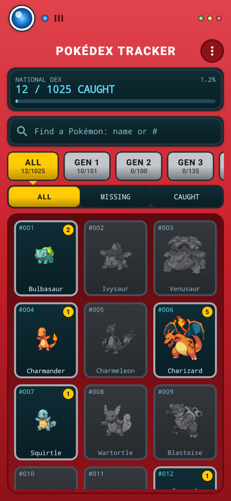
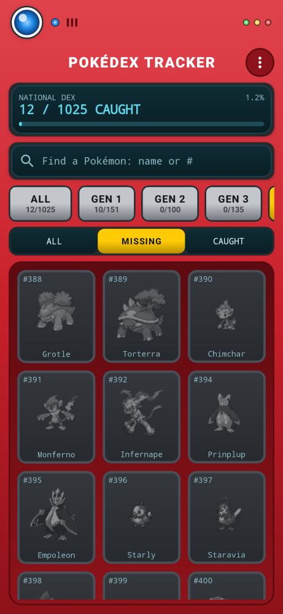
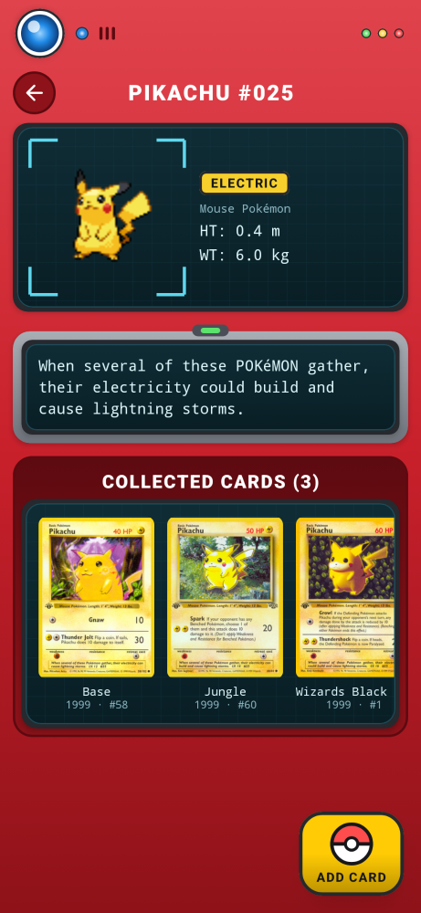
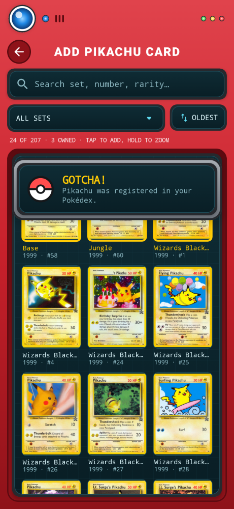

# Pokédex Tracker (v1.1)

An Android app for collecting the whole National Pokédex (#1–1025, Gen 1–9) in Pokémon TCG
cards. It looks like a Pokédex: red shell, blue lens, teal screens. A Pokémon counts as caught
once you've logged at least one card of it.

| National Dex | Missing filter | Pokédex Detail | Add Card |
|---|---|---|---|
|  |  |  |  |

## Tech stack

| Concern | Choice |
|---|---|
| UI | Jetpack Compose, Material 3 (custom Pokédex theme) |
| Storage | Room (local only, no account or server), plus JSON backup files |
| Networking | Retrofit + OkHttp + kotlinx.serialization |
| Images | Coil 3, 512 MB persistent disk cache that ignores server cache headers |
| DI | A small manual container (`AppContainer`) |
| Min / target SDK | 26 / 35 |

## Data sources (free, no API key)

| API | Used for | Caching |
|---|---|---|
| [PokeAPI](https://pokeapi.co) | Generation grid, Dex numbers, name, types, height, weight, flavor text, sprites | The species list for #1–1025 is cached in Room on first launch (v1.0 installs top up from 386 automatically). Each detail page is cached in Room the first time it's opened. After that the grid works offline. |
| [Pokémon TCG API](https://pokemontcg.io) | Card search and card art | Live queries, kept in memory for the session. Card art is kept in Coil's disk cache. |

Both APIs are called over HTTPS without any key. The TCG API's keyless tier is rate limited,
which is plenty for one person adding cards by hand. Transient 5xx responses are retried
automatically (`RetryInterceptor`).

### Strict rules engine

`domain/CardRules.kt` hard-filters every TCG result before it reaches the UI:

* Only cards with the **Pokémon** supertype are kept. **Trainer** and Energy cards are dropped.
* **TAG TEAM** cards are dropped.
* **Regional forms** (Alolan, Galarian, Hisuian and Paldean) are all treated the same way. By
  default they're hidden, so an Alolan Vulpix card doesn't count as Vulpix. Turn on
  **⋮ → Count regional forms** to include them. The check looks at both the name and the subtypes.

The rules are covered by `CardRulesTest`.

## Screen flow

1. **National Dex grid**
   * A **National Dex counter** ("37 / 1025 CAUGHT", with a percentage and progress bar).
   * A scrolling row of tabs: **All**, then **Gen 1** to **Gen 9**, each showing its own
     progress ("GEN 2 · 4/100"). A ✓ marks a completed generation.
   * An **All / Missing / Caught** filter. "Missing" is your to-catch list.
   * **Search** by name or number. "pika", "mr mime", "flabebe", "25" and "#025" all work. A
     search covers every generation. Pressing search when there's exactly one match opens it.
   * Each tile shows the number, the name and a sprite. Pokémon you have no cards for are gray.
     Collected ones are in color with a yellow badge showing how many unique variants you own.
   * The scroll position is kept when you come back from a Pokémon. The Pokédex hardware strip
     folds away while you scroll so the grid gets more room.
   * **⋮ menu**: back up the collection, restore from a backup, and count regional forms.
2. **Pokédex Detail**: the top half shows PokeAPI data (name, Dex #, types, height, weight,
   flavor text). Below it is a scrolling gallery of the cards you own. Tap a card to zoom in or
   remove it. The yellow **ADD CARD** button sits bottom-right.
3. **Add Card (auto-query)**: opening it immediately searches for every valid card of that
   Pokémon, with the exclusion rules applied, and shows them in a grid.
   * **Filter by Set** dropdown (each set shows its year and card count)
   * **Sort by year** toggle (oldest/newest)
   * Free-text search over set, series, number, rarity and year
   * **Tap a card to add it** straight away. Tap an owned card to remove it. Every change shows
     an **Undo** snackbar, and you stay on the screen so you can add several cards in a row.
     Long-press to zoom. Owned cards get a yellow frame and an **OWNED** tag.
   * Your first card of a Pokémon gets a **"Gotcha!"** banner with a wobbling Poké Ball and a
     haptic buzz. Catching the last missing Pokémon of a generation shows **"Gen N complete!"**.

## Backups

Your collection lives only on your phone, so back it up:

* **⋮ → Back up collection** writes a JSON file to any location the system file picker
  offers (Downloads, Google Drive, etc.).
* **⋮ → Restore from backup** merges a backup into the current collection. Cards you already
  own are kept as they are, so a restore never deletes anything.
* Android's own backup and device-to-device transfer also include the collection and settings.

The search queries by National Dex number (`nationalPokedexNumbers:6 supertype:pokemon`)
rather than by name. That way "Charizard ex", "Dark Charizard" and similar cards are included,
and names like *Farfetch'd*, *Mr. Mime* and *Nidoran♀* don't need escaping.

## Project layout

```
app/src/main/java/com/potentplum/dextracker/
├── data/
│   ├── local/        Room entities, DAOs, database
│   ├── remote/       Retrofit services + DTOs, OkHttp setup
│   ├── backup/       JSON backup format and file import/export
│   ├── PokedexRepository.kt
│   ├── CardRepository.kt
│   └── SettingsRepository.kt
├── domain/           Generation ranges, CardRules engine, Dex search, name formatting, TcgCard
└── ui/
    ├── components/   Pokédex chrome (shell, lens, screens, buttons, Poké Ball, cards)
    ├── grid/         Screen 1
    ├── detail/       Screen 2
    ├── addcard/      Add Card flow
    └── theme/
```

## Building

Requires JDK 17+ and the Android SDK (platform 35).

```bash
./gradlew assembleDebug          # app/build/outputs/apk/debug/app-debug.apk
./gradlew testDebugUnitTest      # rules engine, search, generations, names, backup format
```

Or open the project in Android Studio and run the `app` configuration.
